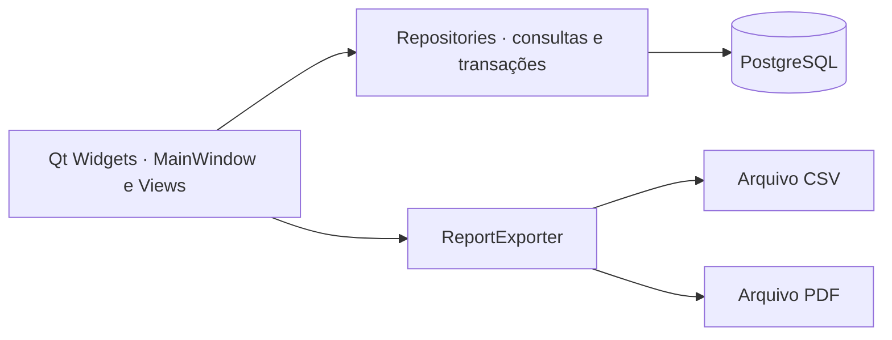

# Sistema de Logística TFD — Prefeitura de Piranga

**Organização do transporte de pacientes em Tratamento Fora de Domicílio, do cadastro à emissão do relatório de viagem.**


[](LICENSE)

Aplicação desktop em C++ e Qt para cadastrar pacientes, organizar viagens, vincular acompanhantes e consultar o histórico de transporte. A persistência em PostgreSQL reúne os registros de pacientes, equipe, veículos e viagens, com validações e restrições de integridade.

[Funcionalidades](#funcionalidades) · [Interface](#interface) · [Como executar](#como-executar) · [Testes](#testes) · [Arquitetura](#arquitetura) · [Licença](#licença)

## Funcionalidades

| Módulo | Recursos disponíveis |
| --- | --- |
| **Pacientes** | Cadastro, consulta por CPF ou nome, atualização de dados e exclusão condicionada aos vínculos existentes. |
| **Cadastros de apoio** | Cadastro e manutenção de motoristas, veículos e auxiliares de viagem. |
| **Viagens** | Cadastro, consulta, edição e exclusão de viagens, com data, destino, veículo, motorista e auxiliar opcional. |
| **Passageiros e acompanhantes** | Inclusão de pacientes na viagem e associação opcional de um acompanhante por paciente. Um novo acompanhante pode ser informado durante esse fluxo, sem cadastro prévio separado. |
| **Consultas operacionais** | Histórico por paciente, volume de passageiros por período e mapa diário de viagens em texto. |
| **Exportação** | Lista de passageiros de uma viagem em CSV e relatório em PDF A4 na orientação paisagem. |

O CSV contém nome, CPF, telefone e informações do acompanhante; utiliza UTF-8 com BOM e ponto e vírgula como separador. O PDF também apresenta os dados da viagem, do veículo e da equipe. A exportação é feita por viagem; as demais consultas são exibidas na interface.

### Regras implementadas

- Validação de CPF, telefone, placa e datas nos fluxos correspondentes.
- Impedimento de inclusão repetida do mesmo paciente na mesma viagem.
- Verificação, por gatilhos no banco, de paciente já vinculado a outra viagem na mesma data, com mensagem na interface.
- No máximo um acompanhante associado a cada paciente em uma viagem.
- Restrições de exclusão para cadastros referenciados por viagens.
- Transações nas operações de gravação de viagens e passageiros.

A exclusão de uma viagem remove também seus vínculos de passageiros. Essas regras de integridade não equivalem a uma trilha de auditoria imutável.

## Interface

A navegação parte de uma tela inicial com acesso a **Pacientes**, **Viagens**, **Relatórios** e **Cadastros**. A interface utiliza Qt Widgets, formulários do Qt Designer e componentes visuais definidos em C++.


<details>
<summary>Ver pacientes, viagens e relatórios</summary>

### Consulta de pacientes


### Planejamento de viagens


### Relatórios


</details>

### Mais imagens podem ser consultadas em 

## Tecnologias

| Finalidade | Tecnologia |
| --- | --- |
| Linguagem | C++17 |
| Interface desktop | Qt 6 Widgets e Qt Designer |
| Banco de dados | PostgreSQL |
| Acesso ao banco | libpqxx e libpq |
| Compilação | CMake, com geração automática de código Qt |
| Testes | CTest, com executáveis de teste em C++ |
| Relatórios | QPdfWriter, QTextDocument e exportação CSV |

## Como executar

O roteiro abaixo utiliza **Windows, PowerShell e MSYS2/MinGW64**, conforme os caminhos previstos na configuração de compilação do projeto.

### 1. Pré-requisitos

- Git.
- Compilador C++17, como o GCC do ambiente MinGW64.
- CMake 3.16 ou superior, mínimo declarado no projeto.
- MinGW Make, para o gerador usado nos comandos abaixo.
- Qt 6 com o módulo Widgets.
- Headers e bibliotecas de desenvolvimento de libpqxx e libpq.
- Um servidor PostgreSQL acessível, com TLS habilitado, e os utilitários `createdb` e `psql`.

Use compilador, Qt e bibliotecas da mesma arquitetura e do mesmo ambiente. Os comandos consideram o prefixo `C:/msys64/mingw64`; ajuste-o se sua instalação for diferente. O projeto ainda não fixa versões de Qt, PostgreSQL e libpqxx em um manifesto de dependências.

### 2. Obter o código

```powershell
git clone https://github.com/Kayke-Oli/Projeto-transporte-Prefeitura-Piranga.git
cd Projeto-transporte-Prefeitura-Piranga
```

### 3. Preparar um banco novo

Com o servidor em execução e os utilitários do PostgreSQL disponíveis no terminal:

```powershell
createdb -h 127.0.0.1 -p 5432 -U postgres prefeitura_viagens
psql -h 127.0.0.1 -p 5432 -U postgres -d prefeitura_viagens -v ON_ERROR_STOP=1 -1 -f src/schema.sql
```

O arquivo `schema.sql` cria as tabelas, funções de validação, índices e gatilhos. Ele deve ser aplicado a um banco vazio; não é um script de atualização de uma instalação existente. A aplicação não cria o banco automaticamente.

#### Bancos existentes

Preserve os dados e faça backup antes de atualizar o esquema. Escolha as migrações de acordo com a versão da base; não execute todos os scripts indiscriminadamente nem reaplique o schema completo.

| Script em `src/` | Finalidade |
| --- | --- |
| `migracao_pacientes.sql` | Normalização de pacientes, função de validação de CPF e restrições de integridade. |
| `migracao_cadastros_auxiliares.sql` | Normalização e validação dos cadastros de acompanhantes, motoristas e veículos. |
| `migracao_auxiliares_relatorios.sql` | Auxiliares de viagem e vínculo de um paciente cadastrado como acompanhante. |
| `migracao_acompanhantes_por_viagem.sql` | Dados de acompanhante informados diretamente no vínculo da viagem. |
| `migracao_paciente_uma_viagem_por_dia.sql` | Gatilhos de verificação de participação do paciente por data. |

As migrações que utilizam `cpf_valido` pressupõem que essa função já exista. Quando ambas forem necessárias, aplique `migracao_auxiliares_relatorios.sql` antes de `migracao_acompanhantes_por_viagem.sql`, pois alteram a mesma restrição. Um banco novo criado com o schema atual já possui essas estruturas.

### 4. Configurar a conexão

Defina as variáveis no **mesmo terminal** em que abrirá o aplicativo:

```powershell
$env:DB_HOST = "127.0.0.1"
$env:DB_PORT = "5432"
$env:DB_NAME = "prefeitura_viagens"
$env:DB_USER = "postgres"
$env:DB_PASSWORD = "SUBSTITUA_PELA_SENHA_DO_BANCO"
$env:DB_SSLMODE = "require"
```

| Variável | Padrão | Observação |
| --- | --- | --- |
| `DB_HOST` | `127.0.0.1` | Endereço do servidor. |
| `DB_PORT` | `5432` | Porta numérica entre 1 e 65535. |
| `DB_NAME` | `prefeitura_viagens` | Banco utilizado pela aplicação. |
| `DB_USER` | `postgres` | Usuário de conexão. |
| `DB_PASSWORD` | Sem padrão utilizável | Obrigatória e não vazia. |
| `DB_SSLMODE` | `require` | Aceita `require`, `verify-ca` ou `verify-full`. |
| `DB_SSLROOTCERT` | Não definido | Caminho do certificado da autoridade certificadora, obrigatório para `verify-ca` e `verify-full`. |

Para validar a identidade do servidor, configure `verify-full`, um certificado de autoridade confiável e um `DB_HOST` compatível com o certificado. O modo `require` exige criptografia, mas não oferece a mesma verificação de identidade. O servidor precisa oferecer TLS inclusive no ambiente de desenvolvimento.

O código lê variáveis do processo; não há carregamento automático de arquivo `.env`. Para uso operacional, configure um usuário de banco com as permissões necessárias ao aplicativo, em vez de compartilhar uma conta administrativa.

### 5. Compilar e iniciar

```powershell
$env:Path = "C:\msys64\mingw64\bin;" + $env:Path

cmake -S . -B build -G "MinGW Makefiles" -DCMAKE_PREFIX_PATH=C:/msys64/mingw64 -DBUILD_TESTING=ON
cmake --build build --parallel

.\build\sistema_prefeitura.exe
```

Use uma pasta de compilação nova ao trocar de gerador ou compilador. As DLLs do Qt, libpqxx, libpq e suas dependências precisam estar acessíveis durante a execução. A janela principal só é aberta após a conexão com PostgreSQL.

### 6. Primeiro uso

1. Em **Cadastros**, registre o motorista, o veículo e, quando necessário, o auxiliar de viagem.
2. Em **Pacientes**, cadastre os pacientes que serão transportados.
3. Em **Viagens**, defina data, destino, veículo e equipe; adicione os passageiros e os acompanhantes opcionais.
4. Salve a viagem e consulte os dados registrados.
5. Em **Relatórios**, consulte histórico, volume por período ou mapa diário. Selecione a data e a viagem para exportar CSV ou PDF.

## Testes

Após compilar com `BUILD_TESTING=ON`, execute:

```powershell
Push-Location build
ctest --output-on-failure
Pop-Location
```

| Teste | Escopo atual |
| --- | --- |
| `core_utils_tests` | Normalização e validação de CPF; conversão e validação de datas, incluindo anos bissextos. |
| `report_exporter_tests` | Exportação CSV com verificação de conteúdo e criação de um PDF não vazio a partir de dados de teste. |

Esses testes não precisam de uma conexão com PostgreSQL. O teste de relatórios utiliza Qt e requer suas bibliotecas e plugins disponíveis. Em um ambiente sem tela, pode-se configurar `$env:QT_QPA_PLATFORM = "offscreen"` quando o plugin estiver instalado.

A verificação atual de PDF não substitui a revisão visual de paginação e legibilidade. Testes de integração com o banco ainda são uma evolução proposta.

## Arquitetura



- **Interface:** `MainWindow` organiza a navegação; as classes `View*` apresentam formulários, tabelas e mensagens.
- **Persistência:** os repositórios executam consultas parametrizadas e operações transacionais via libpqxx.
- **Conexão:** `Database.h` concentra a configuração por ambiente e a abertura/revalidação da conexão.
- **Domínio:** `Entidades.h` define as estruturas de dados compartilhadas.
- **Validação:** `CpfUtils.h` e `DataUtils.h` tratam CPF e datas; o schema complementa as verificações com restrições relacionais.
- **Exportação:** `ReportExporter` recebe os dados de uma viagem e gera CSV ou PDF.

### Estrutura principal

```text
.
├── src/
│   ├── main.cpp                   # Inicialização, tema e conexão
│   ├── MainWindow.*               # Janela principal e navegação
│   ├── View*                      # Telas C++ e formulários .ui
│   ├── *Repository.*              # Persistência e consultas
│   ├── Database.h                 # Conexão com PostgreSQL
│   ├── Entidades.h                # Estruturas do domínio
│   ├── CpfUtils.h / DataUtils.h   # Validações e conversões
│   ├── AppTheme.h                 # Tema e marca incorporada
│   ├── ClickableCard.*            # Componente de navegação
│   ├── ReportExporter.*           # Exportação CSV e PDF
│   ├── schema.sql                 # Estrutura inicial do banco
│   └── migracao_*.sql             # Atualizações de bases existentes
├── tests/
│   ├── CoreUtilsTests.cpp
│   └── ReportExporterTests.cpp
├── docs/
    └── screenshots/
        └── Tela inicial.png       # Contém todas as imagens do aplicativo
├── CMakeLists.txt
├── .gitignore
├── LICENSE
└── README.md
```

Pastas de compilação e relatórios gerados não fazem parte do código-fonte necessário para manter o projeto.

## Solução de problemas

| Situação | O que verificar |
| --- | --- |
| `DB_PASSWORD não foi definida` | Configure a variável no terminal que inicia o programa. |
| Conexão recusada ou banco indisponível | Serviço PostgreSQL, endereço, porta, credenciais, nome do banco e configuração TLS. |
| Falha de certificado | Caminho em `DB_SSLROOTCERT`, cadeia de confiança e nome do servidor no modo `verify-full`. |
| Qt 6 ou libpqxx não encontrados | Dependências de desenvolvimento, arquitetura e prefixo informado ao CMake. |
| DLL ou plugin Qt não encontrado | Ambiente de execução e distribuição das bibliotecas e plugins. |
| Erro de coluna ou tabela inexistente | Compatibilidade da base com o schema e as migrações necessárias. |

## Licença

Distribuído sob a [licença MIT](LICENSE).

Desenvolvido por **Kayke Rodrigues de Oliveira** — [@Kayke-Oli](https://github.com/Kayke-Oli).
